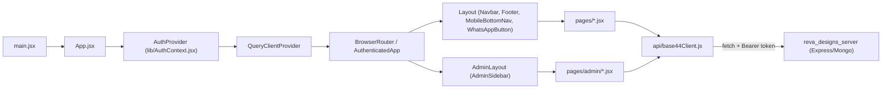

# ARCHITECTURE – reva_designs_frontend

## Real architecture (VERIFIED)

Client-only SPA. Pages fetch directly from a single API client module; there is no service layer, store, or custom data hooks (`useStoreSettings` exists but is unused). Server rules are minimal, so **business logic (totals, coupons, order creation) lives in page components**.

## Boundaries

- **Route tree** (`src/App.jsx`): public auth pages (`/login`, `/register`, `/forgot-password`, `/reset-password`) outside `Layout`; storefront pages inside `Layout`; `/admin/*` inside `AdminLayout`; `*` -> `PageNotFound`.
- **Auth state:** `AuthContext` holds `user`, `isAuthenticated`, `isLoadingAuth`, `authError`; token in `localStorage['reva_designs_token']` managed by `base44Client.js`.
- **No guarding:** `AdminLayout` and storefront routes perform no auth/role check; `components/ProtectedRoute.jsx` exists but is not used anywhere.
- **Data boundary:** every network call goes through `base44` in `src/api/base44Client.js`. Pages must not call `fetch` directly.
- **Shared state patterns:** none; all data is per-component state refetched on mount/after mutation (the module-cached `useStoreSettings()` hook is unused).
- **Layout parts** (`Navbar`) refetch cart count and categories on every location change.

## Cross-project

- Server is authoritative for schema; `entities/*` JSON files here mirror server models (hand-maintained; may drift, e.g. `Checkout.jsx` sends `payment_method`/`utr_number`, which neither `entities/Order` nor the server model define).
- Contract details: `API_AND_DATA_FLOW.md`; server side: `../reva_designs_server-main/.github/context/`.

## Build/Deploy

Vite build to `dist/` (committed). No Docker, CI/CD, hosting config in repo ⚠ NEEDS HUMAN VERIFICATION how it is deployed.
